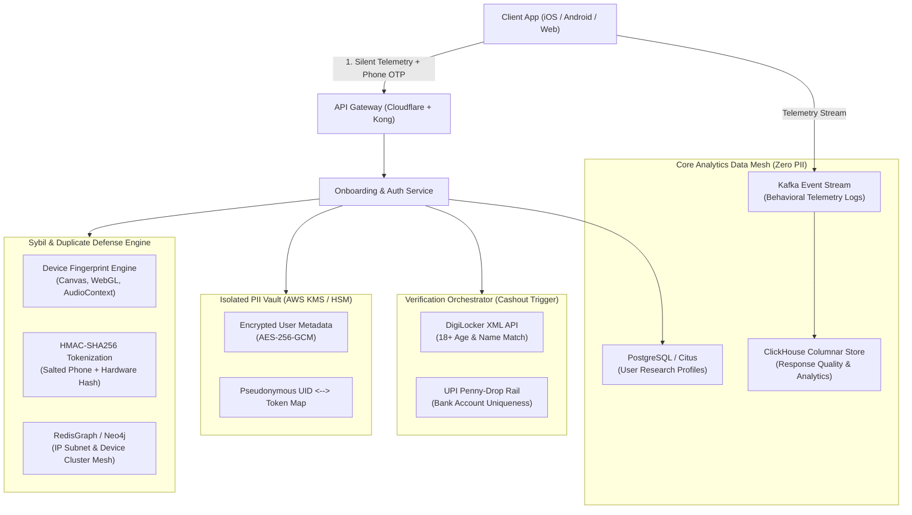

# Product and Engineering Proposal: Intelligent Research Engine & Trustworthy Consumer Verification System
**Company:** Hot Takes (`hottakes.io`)  
**Role:** Product & AI Engineering Intern / Engineer  
**Author:** Candidate Submission  
**Date:** November 2026  

---

## Executive Overview
Hot Takes is fundamentally transforming consumer market research by moving away from sterile, static surveys toward dynamic, gamified consumer intelligence. 

Traditional market research suffers from two structural existential crises:
1. **The Stated vs. Revealed Preference Dilemma:** Conventional surveys capture what consumers *wish* they did or what they think sounds socially virtuous (e.g., *"I always buy eco-friendly"*), rather than authentic consumer behavior under financial and cognitive trade-offs.
2. **The Panel Trust & Sybil Crisis:** Incentive-driven consumer panels attract professional survey-takers, bots, and multi-accounting fraud rings who speed through questions to harvest rewards, poisoning brand data.

This proposal details the architectural and product blueprint for:
* **Challenge 1:** Transforming static question generation into an **Intelligent Research & Behavioural Telemetry Engine**, complete with micro-budget trade-off mechanics and real-time Response Quality Scoring (RQS).
* **Challenge 2:** A **Trustworthy Consumer Onboarding & Progressive Verification Architecture**, balancing frictionless top-of-funnel conversion with bank-grade Sybil fraud prevention and DPDP Act 2023 compliance.

---

# CHALLENGE 1: Building a More Intelligent Research Engine

```
+------------------------------------------------------------------------------------------------+
|                         HOT TAKES INTELLIGENT RESEARCH ENGINE PIPELINE                         |
+------------------------------------------------------------------------------------------------+
|  1. AI Question Transformation Studio (De-biasing, Projective Framing, Trade-off Injection)    |
|                                            ▼                                                   |
|  2. Gamified Interaction Layer (Micro-Budget Conjoint, Rapid Swipe Dilemma, Blind Allocation)  |
|                                            ▼                                                   |
|  3. Client-Side Telemetry Engine (Dwell Time, Micro-Jitter, Cognitive Hesitation, Reversals)   |
|                                            ▼                                                   |
|  4. Real-Time Response Quality & Anomaly Engine (RQS, Shannon Entropy, Straight-Line Filter)   |
|                                            ▼                                                   |
|  5. Consumer Truth Graph & Continuous Model Recalibration Loop                                 |
+------------------------------------------------------------------------------------------------+
```

---

## Part A: Question Intelligence

### 1. The Breakdown of Conventional Questions
Conventional surveys fail due to four well-documented cognitive distortions:
* **Social Desirability Bias (SDB):** When asked about ethics, sustainability, fitness, or privacy, respondents subconsciously answer to maintain ego-defense and social status.
* **Acquiescence Bias ("Yeah-Saying"):** Given an unconstrained Likert scale (1 to 5), participants overwhelmingly default to agreeable ratings (4s and 5s).
* **Zero Economic Friction:** Stating that eco-packaging is "Extremely Important" costs the respondent zero dollars and zero minutes. Without a constrained budget, stated preference has near-zero predictive power.
* **Predictable Answering Patterns:** Long grids of radio buttons encourage "straight-lining" (clicking option 3 or 4 repeatedly) to minimize cognitive strain.

### 2. Prototype Demonstration: Transformation of a Conventional Question

| Dimension | Conventional Method | Hot Takes Gamified Redesign |
| :--- | :--- | :--- |
| **Category** | FMCG / E-Commerce Delivery | Sustainable Consumption vs Price Sensitivity |
| **Original Question** | *"How important is eco-friendly, carbon-neutral packaging when you order food or retail items online? (1: Not important to 5: Extremely important)"* | **"The Cart Dilemma / The Micro-Budget Auction"** (Interactive Prototype) |
| **Psychological Flaw** | 84% choose 4 or 5 because admitting lack of eco-concern causes cognitive dissonance. Generates false commercial signals for brands. | Forces respondent to balance a finite **100-Credit Wallet** across 3 competing levers: Packaging material (+₹25), Delivery speed (15-min instant vs 45-min green electric batch), and Direct Cashback vs Tree Planting. |
| **Gamified Mechanism** | Static 5-point radio button scale. | Dynamic token allocation, real-time wallet debiting, and rapid blind card swipes with time decay. |
| **Behavioral Construct** | Hypothetical moral virtue / self-perception. | **Revealed Willingness to Pay (WTP)** and elasticity of green demand under true convenience/price penalties. |

### 3. Hot Takes Question Transformation Taxonomy
To systematize this across any industry, Hot Takes deploys a 4-tier Question Transformation Matrix:

```
+-----------------------------------------------------------------------------------------+
| FORMAT 1: Micro-Budget Conjoint Auction                                                 |
| Best For: Pricing elasticity, feature prioritization, packaging trade-offs              |
| Mechanic: User allocates finite tokens across competing desirable features.             |
+-----------------------------------------------------------------------------------------+
| FORMAT 2: Time-Decay Rapid Swipe Dilemma (3.5-second decision window)                   |
| Best For: Brand sentiment, impulse purchasing, implicit associations                   |
| Mechanic: High-speed forced choice between 2 options; bypasses prefrontal filter.      |
+-----------------------------------------------------------------------------------------+
| FORMAT 3: Projective Roleplay Simulation ("The Colleague Test")                         |
| Best For: Stigmatized behaviors (piracy, designer counterfeits, alcohol, debt)          |
| Mechanic: Asks what "your colleague or neighbour" would choose in a realistic dilemma.  |
+-----------------------------------------------------------------------------------------+
| FORMAT 4: Mystery Card / Blind Reveal                                                   |
| Best For: True product value, unbranded packaging perception                           |
| Mechanic: Hides brand logo until feature preferences are locked in.                     |
+-----------------------------------------------------------------------------------------+
```

### 4. Automated AI Evaluation & Validation Pipeline
Before any generated question reaches consumers, it passes through an automated LLM Evaluation Agent evaluating 4 objective rubrics:
1. **Linguistic Neutrality Index (LNI):** Scored via syntactic sentiment analysis to ensure prompt contains zero leading adjectives (*"Do you agree that innovative eco-friendly packaging..."* is flagged and rewritten).
2. **Social Desirability Risk Score (SDR):** Detects moralized keywords and predicts probability of skew. If SDR > 65%, the question is rejected from Likert format and automatically converted to a trade-off auction.
3. **Construct Invariance Test:** Uses few-shot embeddings to verify that the gamified mechanic measures the exact target psychometric construct without creating confounding game-rule complexity.
4. **Flesch-Kincaid Reading Grade:** Ensures prompt is readable at an 8th-grade level to prevent cognitive fatigue.

---

## Part B: Behavioural Tracking and Response Intelligence

### 1. Telemetry Capture Architecture
To distinguish authentic engagement from rushed guessing or bot scripts, Hot Takes captures background behavioral telemetry on every user interaction:

```
+-----------------------------------------------------------------------------------------+
| CLIENT-SIDE TELEMETRY COLLECTOR (DOM & Canvas Level)                                    |
+-----------------------------------------------------------------------------------------+
| • time_to_first_interaction_ms  : Latency between screen mount and initial pointer move|
| • total_dwell_time_ms           : Total active dwell before commitment                  |
| • reading_speed_wpm             : Word count divided by dwell time                      |
| • answer_flips_count            : Number of times user toggled or reversed choices      |
| • cursor_jitter_variance (σ²)   : Micro-movements of pointer (detects bezier bot paths) |
| • swipe_velocity_angle          : Touch vector angle and acceleration curves            |
| • choice_entropy_battery (H)    : Shannon entropy across current study session          |
+-----------------------------------------------------------------------------------------+
                                            │
                                            ▼ (Compressed Protobuf / Web Worker)
+-----------------------------------------------------------------------------------------+
| INGESTION PIPELINE (Kafka / EventBridge -> Flink Streaming Analytics)                   |
+-----------------------------------------------------------------------------------------+
```

### 2. Mathematical Formulation of Key Intelligence Scores

#### A. Response Quality Score (RQS: 0–100)
The RQS represents the statistical probability that a given response represents genuine, attentive human cognition:

$$\text{RQS} = \text{clamp}\left(100 \times \left(w_1 S_{\text{pace}} + w_2 S_{\text{deliberation}} + w_3 H_{\text{norm}} + w_4 S_{\text{jitter}}\right) - \sum P_{\text{anomalies}},\, 0,\, 100\right)$$

*Where:*
* **Reading Pace ($S_{\text{pace}}$):** Evaluates dwell time against estimated reading time based on an adult reading speed of 220 words per minute:
  $$S_{\text{pace}} = \begin{cases} 0.1 & \text{if } t_{\text{dwell}} < 0.35 \times t_{\text{expected}} \quad (\text{Speeding Penalty}) \\ 0.85 + 0.15 \tanh\left(\frac{t_{\text{dwell}}}{t_{\text{expected}}} - 1\right) & \text{if healthy deliberation} \end{cases}$$
* **Deliberation Score ($S_{\text{deliberation}}$):** Analyzes answer reversals. In trade-off games, 1–3 toggles represents active cognitive comparison ($S = 1.0$). 0 toggles with low dwell indicates unthinking taps ($S = 0.5$). Greater than 6 toggles indicates erratic confusion ($S = 0.35$).
* **Normalized Shannon Choice Entropy ($H_{\text{norm}}$):** Evaluates choice diversity across a battery of questions to catch straight-liners:
  $$H = -\sum_{i=1}^{k} p_i \log_2(p_i), \quad H_{\text{norm}} = \frac{H}{\log_2(k)}$$
  If $H_{\text{norm}} < 0.35$, straight-lining is flagged.
* **Trajectory Jitter Variance ($S_{\text{jitter}}$):** Natural human mouse and touch movements have micro-tremors and non-linear paths ($\sigma^2 > 4.0$). Automated headless browsers (Puppeteer/Playwright) without custom bezier scripts produce straight-line vectors ($\sigma^2 < 0.5$), which triggers a bot penalty.
* **Anomaly Penalties ($P_{\text{anomalies}}$):** Deducts 15 points per active infraction (`RUSHED_RESPONSE`, `STRAIGHT_LINING`, `BOT_TRAJECTORY`).

#### B. Engagement Score (ES: 0–100)
$$\text{ES} = \text{clamp}\left(100 \times \left(0.40 \cdot \text{InteractionDensity} + 0.35 \cdot \text{ActiveTimeRatio} + 0.25 \cdot \text{MechanicDepth}\right),\, 0,\, 100\right)$$

#### C. The Virtue Gap (Social Desirability Index - SDI)
Quantifies the divergence between stated morality and revealed economic preference:
$$\text{Virtue Gap} = \max\left(0, \text{Stated Importance \%} - \text{Revealed WTP \%}\right)$$
When Virtue Gap $> 50\%$, the brand dashboard alerts researchers: *"High Social Desirability Gap: 78% of consumers claim packaging is critical, but only 18% sacrifice credits or delivery speed for it."*

---

# CHALLENGE 2: Building a Trustworthy Consumer Onboarding and Verification System

```
+--------------------------------------------------------------------------------------------------+
|                     PROGRESSIVE CONSUMER VERIFICATION & ONBOARDING ARCHITECTURE                  |
+--------------------------------------------------------------------------------------------------+
| TIER 0: Pre-Signup Guest Session (Zero Friction)                                                 |
| Browse available Hot Takes games; preview potential rewards; play 1 onboarding tutorial game.    |
+--------------------------------------------------------------------------------------------------+
                                                │ (User completes 1st game)
                                                ▼
| TIER 1: Lightweight Onboarding (10-Second Flow)                                                  |
| Phone OTP (Firebase/Twilio) + Device Fingerprint (FingerprintJS Pro) + Age Self-Attestation.     |
| Status: UNVERIFIED_EARNER | Balance: Earned ₹150 Credits locked in Escrow.                       |
+--------------------------------------------------------------------------------------------------+
                                                │ (User requests "Withdraw Cash / Rewards")
                                                ▼
| TIER 2: Progressive Verification Rail (Triggered Upon Cashout)                                   |
| Option A: UPI VPA Penny-Drop Validation (Cashfree / RazorpayX API) - Frictionless (<5 secs)     |
| Option B: DigiLocker Aadhaar XML Sandbox (Setu / Bureau.id API) - Verified Name & DOB (18+)      |
| Status: VERIFIED_PANELIST_TIER_1 | Identity Hashed into Zero-PII Token Vault.                    |
+--------------------------------------------------------------------------------------------------+
                                                │ (Ongoing Research Participation)
                                                ▼
| TIER 3: Longitudinal Trust & Quality Graph                                                       |
| Cross-study semantic consistency check + Behavioral fraud scoring. Higher Trust = Bigger Rewards |
+--------------------------------------------------------------------------------------------------+
```

---

## 1. Verification Strategy: Aadhaar vs. Alternatives

### 1.1 Comparative Trade-Off Matrix

| Verification Method | Reliability & Accuracy | User Friction / Drop-Off | Cost per Verification | Privacy & Regulatory Compliance (DPDP Act 2023) | Recommendation for Hot Takes |
| :--- | :--- | :--- | :--- | :--- | :--- |
| **Direct Aadhaar OTP (UIDAI KUA)** | Extreme (Government DB match) | **Severe (40–60% drop-off)**. Consumers are deeply suspicious of giving Aadhaar to an unfamiliar app. | High (~₹6–₹12 per OTP/eKYC) | **High Regulatory Burden.** Cannot store Aadhaar numbers; strict CIDR audits; legal penalties. | **NOT Recommended for Onboarding.** Keep only as secondary fallback via DigiLocker. |
| **DigiLocker Aadhaar XML (via Setu/Bureau)** | Extreme (Verified Name + DOB for 18+ check) | Moderate (Requires Aadhaar-linked mobile for DigiLocker OTP) | Moderate (~₹3–₹5) | Excellent. Consumer grants explicit consent; XML contains no raw biometric data. | **Recommended for Tier 2 Cashout** when payout > ₹500. |
| **UPI VPA Penny-Drop Validation** | High (Validates real bank account + legal name match) | **Near Zero (<3% drop-off)**. User simply provides their GPay/PhonePe UPI ID to receive money! | **Low (~₹1.20–₹1.80)** | Exceptional. Bank KYC already performed by issuing bank; Hot Takes never handles bank account numbers. | **PRIMARY RECOMMENDATION for Tier 1 Cashout.** Unbeatable conversion. |
| **Device Fingerprinting + IP Telemetry** | High for Sybil/bot prevention | **Zero (Completely invisible in background)** | Low (~₹0.10) | GDPR/DPDP compliant when anonymized with cryptographic salt. | **Mandatory on all sessions.** |

### 1.2 The Winning Strategy: The Multi-Layered Hybrid Model
Rather than forcing an invasive Aadhaar wall on day one, Hot Takes should implement a **Progressive Verification Pipeline**:
1. **Day 1 Signup:** Phone OTP + Silent Hardware Fingerprint. Cost: ₹0.20. Drop-off: <8%.
2. **First Cashout (₹100–₹500):** **UPI VPA Validation.** Hot Takes sends ₹1 to the user's UPI ID. The UPI banking rail returns the registered account holder name. This establishes bank-level KYC, guarantees uniqueness, and validates that the individual possesses an active financial instrument in India.
3. **High-Value Redemptions (>₹1,000) or High-Stake Enterprise Studies:** **DigiLocker XML.** Confirms 18+ date of birth directly via official government records without storing the raw Aadhaar number.

---

## 2. Consumer Onboarding Experience: "Earn First, Verify Upon Cashout"

### 2.1 The Psychological Onboarding Principle
When an unknown consumer brand demands sensitive identity documents during initial signup, conversion collapses by over 50%. The consumer asks: *"Why do you need my government ID just to answer questions?"*

Hot Takes reverses this equation with **Delayed / Progressive Value Realization**:
1. **Frictionless Top-of-Funnel:** Let the user sign up in 10 seconds and immediately play a game.
2. **Endorphin Hook:** User completes their first game, watches their wallet balance jump to ₹150, and experiences immediate delight.
3. **The Natural KYC Trigger:** When the user taps **"Transfer ₹150 to Bank / UPI"**, the prompt appears:
   > *"To send your ₹150 payout securely and ensure 1 person = 1 account, please verify your payout UPI ID or confirm age (18+) via DigiLocker."*
4. **Zero Psychological Resistance:** The user willingly completes verification because **money is waiting to be deposited into their account**. The verification feels like a security feature protecting their money, rather than an invasive interrogation.

---

## 3. Engineering & System Architecture



### 3.1 Database Schema & Zero-PII Token Mapping

Hot Takes strictly segregates research responses from real-world identities. The core application database never sees or stores government IDs or raw phone numbers.

```sql
-- Core Production Database (Zero PII)
CREATE TABLE user_profiles (
    user_id UUID PRIMARY KEY DEFAULT gen_random_uuid(),
    pseudonym_token VARCHAR(64) UNIQUE NOT NULL, -- Salted HMAC of identity
    device_fingerprint_hash VARCHAR(64) NOT NULL,
    verification_tier SMALLINT DEFAULT 1,        -- 0: Guest, 1: Phone, 2: UPI, 3: DigiLocker
    is_adult_verified BOOLEAN DEFAULT FALSE,
    longitudinal_trust_score NUMERIC(5,2) DEFAULT 50.00,
    wallet_balance_credits INTEGER DEFAULT 0,
    created_at TIMESTAMP WITH TIME ZONE DEFAULT NOW(),
    updated_at TIMESTAMP WITH TIME ZONE DEFAULT NOW()
);

-- Sybil Detection & Uniqueness Constraints
CREATE TABLE identity_uniqueness_registry (
    token_hash VARCHAR(64) PRIMARY KEY,          -- HMAC-SHA256(Identifier, Secret_Salt)
    token_type VARCHAR(20) NOT NULL,             -- 'PHONE', 'UPI_VPA', 'DEVICE_ID'
    bound_user_id UUID NOT NULL REFERENCES user_profiles(user_id),
    first_bound_at TIMESTAMP WITH TIME ZONE DEFAULT NOW()
);

-- Telemetry & Response Integrity Table
CREATE TABLE survey_response_telemetry (
    response_id UUID PRIMARY KEY DEFAULT gen_random_uuid(),
    session_id VARCHAR(64) NOT NULL,
    user_id UUID NOT NULL REFERENCES user_profiles(user_id),
    study_id VARCHAR(64) NOT NULL,
    dwell_time_ms INTEGER NOT NULL,
    time_to_first_interaction_ms INTEGER NOT NULL,
    answer_flips_count SMALLINT NOT NULL,
    cursor_jitter_variance NUMERIC(6,3) NOT NULL,
    choice_entropy NUMERIC(4,3) NOT NULL,
    computed_rqs SMALLINT NOT NULL,
    is_rushed BOOLEAN DEFAULT FALSE,
    is_straight_lined BOOLEAN DEFAULT FALSE,
    payload_json JSONB NOT NULL,
    created_at TIMESTAMP WITH TIME ZONE DEFAULT NOW()
);
```

### 3.2 State Machine for Verification Lifecycle

```
[ UNVERIFIED_GUEST ]
        │  (Completes Phone OTP)
        ▼
[ TIER_1_PHONE_VERIFIED ] ──(Exceeds Fraud Threshold)──> [ SUSPENDED_SYBIL_DETECTED ]
        │
        │  (Requests Payout > ₹100)
        ▼
[ KYC_IN_PROGRESS ]
   ├──(UPI / DigiLocker Timeout)──> [ KYC_RETRY_SCHEDULED ] (Max 3 retries)
   ├──(Name Mismatch / <18 DOB)───> [ KYC_FAILED_INELIGIBLE ]
   └──(Success)───────────────────> [ TIER_2_VERIFIED_PANELIST ]
```

### 3.3 Sybil & Multi-Account Prevention Mechanisms
To prevent single users from running 10 emulator accounts to farm rewards:
1. **Device Hardware Fingerprinting:** Combines WebGL rendering hashes, Canvas fingerprinting, AudioContext latency, and hardware concurrency. Emulators and cloned Android virtual spaces are detected via missing sensor APIs and cloned renderer strings.
2. **Payment Rail Uniqueness:** Every payout requires a unique UPI VPA or Bank Account. Since Indian banks require physical Aadhaar/PAN verification to issue a bank account, enforcing **1 UPI VPA = 1 Hot Takes Profile** effectively outsources Sybil resistance to the Reserve Bank of India's banking infrastructure!
3. **IP Subnet Graph Clustering:** If more than 3 accounts submit responses from the same `/24` IPv4 subnet with identical device configurations within a 1-hour window, accounts are quarantined for manual review.

---

## 4. Beyond Initial Verification: Longitudinal Trust & Quality

Identity verification proves that a user is a real person once; it does **NOT** prove that they provide thoughtful responses over time. Hot Takes distinguishes **Identity Verification** from **Response Reliability**:

```
+-------------------------------------------------------------------------------------------------+
|                                 LONGITUDINAL REPUTATION SYSTEM                                  |
+-------------------------------------------------------------------------------------------------+
| 1. Cross-Study Semantic Consistency Check                                                       |
|    • A user who selects "Vegan" in Study A must not allocate 80% budget to steak in Study B.   |
|    • Cosine similarity between persona vector across studies must remain > 0.70.                |
+-------------------------------------------------------------------------------------------------+
| 2. Honeypot & Quality Trap Injection                                                            |
|    • 1 out of every 25 questions is a control trap: "Select the second option to prove you're   |
|      human" or an obvious logical contradiction. Failing drops Trust Score by 30 points.       |
+-------------------------------------------------------------------------------------------------+
| 3. Dynamic Panelist Tiers & Reward Multipliers                                                  |
|    • Tier 1 (Gold Trust, RQS > 85): Gets invited to premium ₹300 brand studies.                 |
|    • Tier 2 (Provisional, RQS 60-84): Standard ₹50 studies.                                     |
|    • Tier 3 (Restricted, RQS < 50): Shadowbanned from high-value brand datasets.               |
+-------------------------------------------------------------------------------------------------+
```

---

## 5. Measuring Success: KPI & Operational Metrics

Hot Takes should monitor onboarding performance, data reliability, and verification economics across 5 core KPI categories:

| Funnel Stage / Domain | Key Performance Indicator (KPI) | Target Benchmark |
| :--- | :--- | :--- |
| **Onboarding Conversion** | App Launch to 1st Game Completed Rate | **> 72%** (Driven by zero upfront KYC friction) |
| **Verification Conversion** | Cashout Request to Successful Verification | **> 85%** (High intent due to earned payout reward) |
| **Verification Cost Efficiency** | Blended Cost per Verified Active Panelist | **< ₹2.50 per verified user** |
| **Fraud & Sybil Defense** | Duplicate Account Interception Rate | **> 98.5%** of multi-account attempts blocked |
| **Research Data Integrity** | Average Response Quality Score (RQS) of Data Pool | **RQS > 82 / 100** across all delivered brand studies |
| **Time to First Engagement** | Time from install to first completed gamified question | **< 60 seconds** |

---

## Conclusion & Engineering Delivery Roadmap
The Hot Takes Intelligent Research Engine and Trustworthy Verification System resolves the fundamental tension in consumer market research: delivering delightful, gamified experiences to consumers while guaranteeing rigorous, un-gamed behavioral truth to enterprise brands. 

The accompanying working prototype, algorithmic engines, and test suites are structured for immediate containerization and deployment within Hot Takes' production infrastructure.
